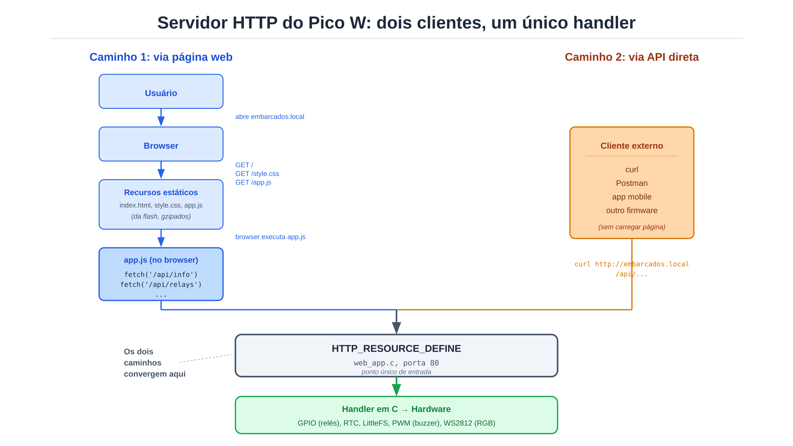
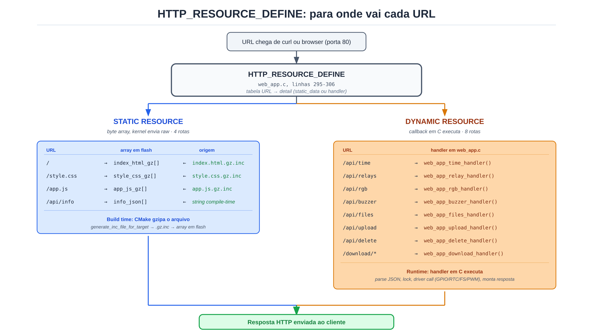

[← README](../../README.md) · [API index](api.md)

# HTTP server architecture

The firmware exposes a single HTTP server on port 80, built on Zephyr's
`CONFIG_HTTP_SERVER`. That server handles two kinds of client which
converge at the same point and, from there, dispatches to two kinds of
resource (STATIC or DYNAMIC) depending on the URL.

## 1. Who calls: two clients, one single handler



**Path 1, through the web page**, the user opens `http://embarcados.local/`,
the browser issues `GET /`, `GET /style.css`, `GET /app.js`, receives the
gzipped files straight from flash, and `app.js` running in the browser
fires `fetch('/api/info')`, `fetch('/api/relays')`, and so on.

**Path 2, through the API directly**, any HTTP client (`curl`, Postman,
a mobile app, another firmware on the network) hits the URL directly,
without ever opening a browser or loading the page.

The page served at `/` is just **one more client** of this REST API, the
only peculiarity being that the Pico W itself also serves that page from
flash. Both paths land on the same `HTTP_RESOURCE_DEFINE` in
[`web_app.c`](../../app/src/web_app.c#L295-L306), the server does not
tell them apart, it is only HTTP.

## 2. Where it goes: STATIC vs DYNAMIC resource

When the URL matches an `HTTP_RESOURCE_DEFINE`, the server picks between
two kinds of resource:



**STATIC RESOURCE**, the `detail` points to a byte array in flash, the
kernel only does a `memcpy` of the bytes into the TCP socket, with no
custom CPU work. There are 4 routes:

| URL          | Array in flash       | Origin                          |
|--------------|----------------------|---------------------------------|
| `/`          | `index_html_gz[]`    | `index.html.gz.inc`             |
| `/style.css` | `style_css_gz[]`     | `style.css.gz.inc`              |
| `/app.js`    | `app_js_gz[]`        | `app.js.gz.inc`                 |
| `/api/info`  | `info_json[]`        | string assembled at compile time |

The first 3 come from the `.gz.inc` files, generated by CMake at build
time through `generate_inc_file_for_target`, which takes
[`app/www/*`](../../app/www/), gzips it and produces a `.inc` holding the
bytes in hex. The `.inc` is included in
[`web_app.c`](../../app/src/web_app.c#L153), becoming a C array that goes
to flash along with the rest of the firmware.

**DYNAMIC RESOURCE**, the `detail` points to a callback function that the
kernel calls on every request. The function decides what to do: parse
JSON, take a lock, call a driver, build the response. There are 8 routes:

| URL            | Handler in [`web_app.c`](../../app/src/web_app.c) |
|----------------|--------------------------------|
| `/api/time`    | `web_app_time_handler()`       |
| `/api/relays`  | `web_app_relay_handler()`      |
| `/api/rgb`     | `web_app_rgb_handler()`        |
| `/api/buzzer`  | `web_app_buzzer_handler()`     |
| `/api/files`   | `web_app_files_handler()`      |
| `/api/upload`  | `web_app_upload_handler()`     |
| `/api/delete`  | `web_app_delete_handler()`     |
| `/download/*`  | `web_app_download_handler()`   |

## 3. When to use STATIC vs DYNAMIC

The rule is: **if the response depends on anything that can change between
boots or between requests, it is dynamic**. Otherwise, it is static.

| Endpoint     | Why it is dynamic                                                       |
|--------------|-------------------------------------------------------------------------|
| `/api/time`  | The RTC ticks every second, the value changes continuously              |
| `/api/relays`| GET reads the GPIO states · POST takes JSON, drives the GPIO, returns the state |
| `/api/rgb`   | GET reads the current color · POST takes RGB, applies it to the WS2812  |
| `/api/buzzer`| POST takes RTTTL in the body, kicks off the PWM thread                  |
| `/api/files` | Lists LittleFS (changes on upload/delete) + total/used statistics       |
| `/api/upload`| Receives a multipart file in chunks, writing as it goes                 |
| `/api/delete`| Takes a path in the body, calls `fs_unlink`                             |
| `/download/*`| Reads a file from the FS, streams it in 1024-byte chunks                |

By contrast, `/api/info` is static (firmware version and author are
constants), and so are the HTML/CSS/JS.

## 4. What the code declares

Zephyr's types make the choice explicit:

```c
// STATIC: everything decided at compile time
struct http_resource_detail_static info_detail = {
    .static_data     = info_json,
    .static_data_len = sizeof(info_json) - 1,
};

// DYNAMIC: callback invoked on every request
struct http_resource_detail_dynamic relay_detail = {
    .cb          = web_app_relay_handler,
    .data_buffer = ...,
};

// Both are registered by the same macro
HTTP_RESOURCE_DEFINE(info_resource,  web_service, "/api/info",   &info_detail);
HTTP_RESOURCE_DEFINE(relay_resource, web_service, "/api/relays", &relay_detail);
```

**Cost:** dynamic spends CPU (JSON parsing, locking, driver calls) and RAM
(buffers). Static is practically free, just the TCP kernel pushing bytes
out of flash.

---

[← README](../../README.md) · [API index](api.md)
